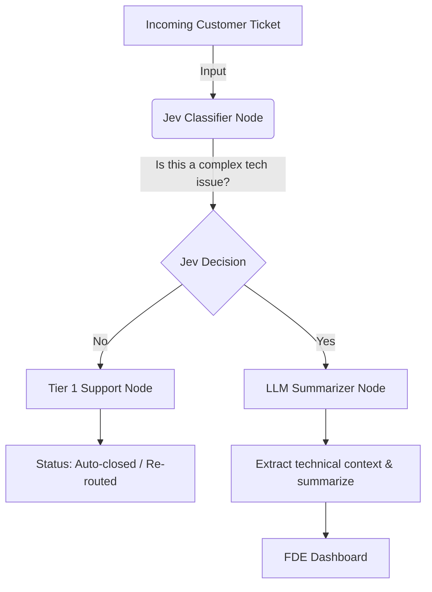

# FDE Ticket Escalator (Powered by Jev & LangGraph)

This repository contains an agent built specifically for the **Forward Deployed Engineer (FDE)** role. It uses **LangGraph** to route and process customer support tickets. 

## The Problem
FDEs are highly paid technical problem solvers, but they constantly get pinged on Jira/Zendesk for basic issues (like "reset my password" or "where is the billing page?").

## The Solution
This agent reads incoming customer messages, uses **Jev** to instantly decide if it's a real technical problem, and if it is, uses a standard LLM to write a quick technical summary so the FDE can fix it faster.

### Architecture

The workflow consists of a LangGraph state machine:
1. **Node 1 (Jev Decision):** We use a simulated Jev (System One) model to quickly classify the ticket as `FDE Required` or `Basic Issue`.
2. **Conditional Routing:** LangGraph uses the Jev output to route the ticket.
3. **Node 2 (Basic Auto-Reply):** If Jev routes it as a basic issue, it is instantly closed and sent to Tier 1 support.
4. **Node 3 (LLM Summarizer):** If Jev routes it to the FDE, a heavier "System Two" LLM kicks in to extract the API endpoint, error code, and summarize the issue in 3 bullet points for the senior engineer.

## How to Run

1. `pip install -r requirements.txt`
2. Set your `GOOGLE_API_KEY` (or the API key of your chosen LLM) in your environment variables.
3. `python app.py`

*(Note: In this demo, Jev's high-speed decision capabilities are mocked using a standard LLM call acting as the classifier).*
